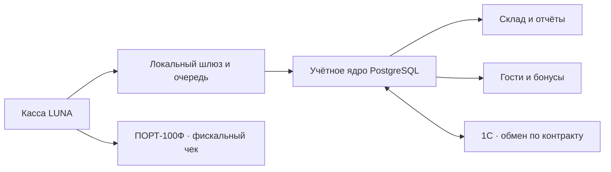

# Fish_opt_krg · как адаптировать LUNA

## Подтверждённые входные данные

| Поле | Значение | Источник |
|---|---|---|
| Компания | Fish_opt_krg, рыба, морепродукты, мясо, готовые блюда | анкета 18.11.2026 |
| Сеть | 5 филиалов, 20 сотрудников | анкета |
| Текущая учётная программа | 1С | анкета |
| Касса | ПОРТ-100Ф | подтверждение пользователя по фото |
| Каталог | 326 позиций, цена, категория, штрихкод, NTIN, вес, единица, страна, 4 акционные цены | прайс Fish Dream 26.09.2026; нормализован в `catalog_2026-09-26.csv` |
| Приоритет | привлечение и удержание клиентов | анкета |

Адреса, реальные закупочные цены, складские остатки, сотрудники, покупатели, объёмы продаж, скидки и договор с ОФД не предоставлены. В демо они вымышлены или явно помечены как оценка. Прайс датирован сентябрём: до рабочего запуска сверить его актуальность и разрешение использовать его для всех пяти филиалов.

Проверка импорта выявила **24 повторяющихся штрихкода** у разных строк прайса. Сканирование такого кода нельзя автоматически сопоставлять с единственным товаром; нужна таблица соответствий 1С или отдельный артикул/этикетка для каждой позиции. В файле 15 категорий, включая икру, рыбу, снеки и полуфабрикаты. Несмотря на упоминание мяса в анкете, отдельной подтверждённой мясной номенклатуры в этом прайсе нет: не добавлять её как реальные товары без следующего источника.

## Каноническая архитектура LUNA и роли сторон

`LUNA_POS/app` — экран кассира; `LUNA_POS/integration/gateway.py` — локальный шлюз, очередь отправки и восстановление после потери связи; `LUNA_POS_Postgre/orchestrator-finance-module/app` — общая PostgreSQL база товаров, документов, продаж, складов, денег, гостей и журнала бонусов. `warehouse.html` — учётный интерфейс. Это основа будущей установки Fish_opt_krg, а текущий `fish-opt-krg/app.py` — независимый прототип процесса для показа, не копия этих служб.

Схема двух последних связей целевая: адаптеры 1С и ПОРТ-100Ф пока не написаны и не проверены на оборудовании. Фискальный чек и товарный чек системы нельзя смешивать: оплата считается завершённой лишь после согласованного результата фискализации; ошибки и повторы требуют отдельного статуса и сверки.

## Учётные сценарии

| Сценарий | Путь в LUNA | Особенность рыбного магазина |
|---|---|---|
| Номенклатура | Product → ассортимент филиала → позиция кассы | один `product_id` для штрихкода, чека, остатка и бонусов; одинаковые штрихкоды в исходном прайсе требуют разбор неоднозначностей по номенклатуре |
| Прайс | базовая цена + цена филиала/акции | 326 цен из файла; 4 значения «Акция» равны базовым ценам и потому не дают скидку; срок неизвестен; товары `кг`, `шт`, `упак` продавать в их единице |
| Приёмка | поставщик → накладная → проверка → проведение → остаток/себестоимость | фактический вес, партия, срок годности и температура; себестоимость только из накладной, не из 70% оценки демо |
| Перемещение | расход центрального/исходного склада → приёмка точки | нельзя увеличивать остаток назначения до подтверждения приёмки; корректировать расхождения документом |
| Списание | причина → проверка → проведение/сторно | порча, срок годности, усушка; положительное количество и положительная стоимость, отдельный финансовый знак проводки |
| Продажа | смена → корзина → оплата → фискализация → событие SALE → движение/деньги/бонусы | вес с весов/этикетки, отдельные позиции чека, цена за кг, смешанная оплата и возврат |
| Лояльность | телефон гостя → правило программы → чек → единый журнал | общесетевой гость; начисление и списание в том же проведении, что продажа; бонусные 3% в демо не являются согласованным правилом |
| Возврат | ссылка на исходный чек → возврат → обратное движение/деньги/бонусы | частичный весовой возврат, сторно бонусов и фискальный чек возврата |
| Отчёты | чеки, движения, P&L, остатки, клиенты | разрез по филиалу, категории, весовым товарам, порче, марже и повторным покупкам |
| Люди | роли, филиалы, кассовые смены | 20 человек распределить по фактическим точкам; кофейные HR шаблоны и зарплатные правила не включать без отдельной политики |

## 1С: правило владения данными

До синхронизации согласовать конфигурацию и релиз 1С, способ обмена, ключи номенклатуры, код филиала, единицы и коэффициенты, момент проведения, справочник контрагентов и правила конфликтов. Практичный старт: 1С — источник утверждённой номенклатуры и закупочных документов, LUNA — источник чеков/клиентов/бонусного журнала; взаимный обмен только через idempotency key и таблицу соответствий 1С GUID ↔ Product/Branch/Document ID. Это **предложение**, не подтверждённое решение магазина. Не импортировать остатки повторно после начала продаж: нужна стартовая инвентаризация и дата отсечения.

Экспорт `GET /export/stock.csv` в прототипе — лишь пример файла согласования. Прямого чтения или записи в 1С сейчас нет.

## ПОРТ-100Ф

Модель подтверждена. Драйверу нужны порт и режим связи конкретной кассы, документация по протоколу данной прошивки, регистрационные параметры, ставки налогов/ОФД и тестовые сценарии: печать продажи, неуспешная печать, повтор после таймаута, частичный возврат, наличные/карта/смешанная оплата, весовая позиция, смена. Устройство не является обычным ESC/POS принтером: отправка текста по TCP 9100, использованная для Xprinter Luna Coffee, не подтверждает фискализацию ПОРТ-100Ф. До аппаратного теста кнопка «Фискализировать» в Fish_opt_krg не активируется.

## Что уже сделано в отдельном стенде

- Нормализован прайс без внутренних контактных данных; цены и карточки из файла, 5 точек, 20 сотрудников, 12 гостей, 150 исторических учебных продаж, складские движения.
- Приход, списание и продажа меняют остатки; бонусы начисляются на чек с клиентом; повтор `request_id` не создаёт второй чек.
- Правила акций в локальном демо: срок, товар, филиал, минимальное количество, сниженная цена или процент; выбор наиболее выгодного подходящего правила, скидка в чеке и бонусы от оплаты после скидки. Четыре строки прайса выключены, поскольку не содержат реального снижения цены.
- CSV остатков и пояснение источника цены/оценки себестоимости.

## Что нужно реализовать перед пилотом на каноническом стеке

1. Отдельный проект/организация и PostgreSQL база Fish_opt_krg, 5 реальных Branch/Warehouse, права сотрудников и терминалы; без данных и секретов Luna Coffee.
2. Импорт номенклатуры с проверкой дубликатов штрихкода, весовых единиц, акций и соответствий 1С; закупочные цены и остатки — по реальным документам.
3. Кассовое меню из `product_id`, сканер и весы/штрихкод этикетки, корзина и смена; сквозной SALE через существующий gateway/outbox.
4. Согласованные правила лояльности (начисление, лимит оплаты, возвраты, исключения акционных товаров, срок и филиалы) через конфигурацию программ, а не демо-константу.
5. Адаптер ПОРТ-100Ф и журнал фискального статуса, сверка с ОФД и исходным чеком; тест на самом устройстве.
6. Согласованный обмен с 1С с повторяемым импортом, экспортом и отчётом о расхождениях; сверка закупок, продаж и остатка.
7. Приёмка по каждому филиалу: один весовой товар, один штучный, акция, бонус, нет сети, повтор события, частичный возврат, порча, приход, закрытие смены, отчёт за день.

Пока пункты 1–7 не выполнены и не проверены на реальных 1С/кассе, стенд не должен использоваться для операций магазина.
